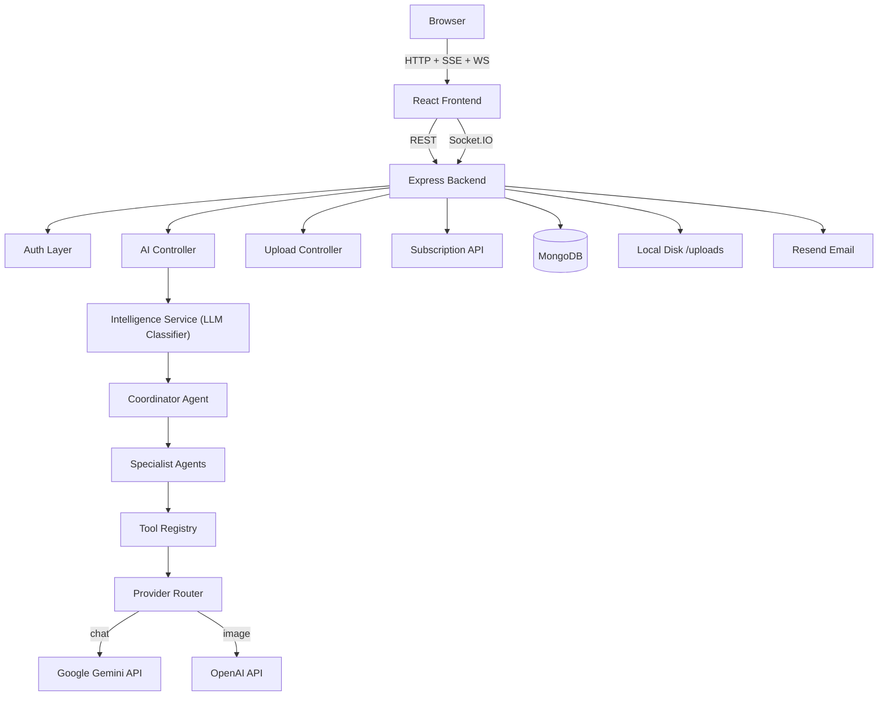

# Champ.ai — AI Voice Companion

A full-stack, multimodal AI chat platform with real-time streaming, voice conversation mode, image generation/editing, document analysis, multi-provider AI routing, and a tiered subscription system.

---

## Overview

Champ.ai is a personal AI assistant built as a monorepo with a React + TypeScript frontend and a Node.js + Express backend. Users converse in text or voice, upload files for analysis, generate and edit images with AI, and manage multiple chat sessions. The system routes requests through a pluggable provider layer — Google Gemini for chat/analysis and OpenAI for image generation and editing — and enforces per-plan daily usage quotas.

The assistant is bilingual by design: it automatically detects and matches the user's language between English, Tamil (Unicode script), and Tanglish (Tamil written in Latin script).

---

## Features

### Chat

- **Real-time token streaming** — responses stream token-by-token over SSE (`/api/ai/stream`)
- **Multi-session chat management** — create, switch, and auto-title conversations
- **Markdown rendering** — assistant responses render full markdown including code blocks
- **Drag-and-drop file upload** — drag files directly onto the chat window
- **Copy and TTS per message** — copy to clipboard or read any message aloud via the Web Speech API

### Voice Mode

- **Full voice conversation overlay** — microphone input (Web Speech API), real-time transcription, progressive AI response playback
- **Bilingual voice support** — Auto / English / Tamil language selection persisted to localStorage
- **Semantic turn detection** — custom `semanticDetector` utility identifies natural speech end-of-turn boundaries
- **Sentence-by-sentence TTS queue** — `speechSynthesisHelper` splits AI responses and speaks them progressively during streaming
- **Latency metrics** — tracks speech-end to first-token and first-audio timestamps internally

### AI Capabilities

| Capability | Status | Provider |
|---|---|---|
| General text chat | Active | Gemini |
| Code generation and debugging | Active | Gemini |
| Image generation | Active | OpenAI (gpt-image-2) |
| Image editing | Active | OpenAI (gpt-image-2 edit) |
| Image / vision analysis | Active | Gemini |
| Document analysis (PDF, DOCX, TXT, CSV) | Active | Gemini |
| OCR (text from images) | Active | Gemini |
| Translation (English / Tamil and others) | Active | Gemini |
| Summarization | Active | Gemini |
| Reasoning and mathematics | Active | Gemini |
| Creative writing | Active | Gemini |
| Web search | Planned | — |
| Video generation | Planned | — |
| Long-term memory | Planned | — |
| Task management | Planned | — |

### Multi-Agent / Tool Architecture

- **Coordinator Agent** — classifies user intent via `IntelligenceService` (LLM-based JSON classifier) and routes to the correct specialist agent
- **Agents**: Conversation, Programming, Media, Document, Voice, Reasoning
- **Tools**: Chat, Image Generation, Image Editing, Vision Analysis, Document Analysis, OCR, Translation, Summarization, Reasoning, Code Generation, Code Debugging, Mathematics, Document Generation, and more
- **AI Prompt Optimizer** — before image generation or editing, a secondary LLM call rewrites and structures the prompt for quality and precision

### File Uploads

- Up to **20 MB** per file
- Strict MIME-type whitelist: images (JPEG, PNG, WebP, GIF, SVG), documents (PDF, DOCX, TXT, CSV, XLSX), audio (MP3, WAV, WebM, OGG), video (MP4, WebM)
- Blocked dangerous extensions (.exe, .php, .py, .js, etc.)
- Double-extension detection (e.g. file.php.jpg)
- Files stored on disk under `/uploads/` and served statically

### Authentication

- Email/password registration with **email verification** (30-minute token expiry, hash stored in DB)
- **Google OAuth 2.0** — `@react-oauth/google` on the frontend; `google-auth-library` on the backend
- **JWT access tokens** (15-minute expiry) + **refresh tokens** (7-day expiry), delivered as HttpOnly cookies
- **Multi-device refresh token store** — hashed tokens array per user; per-device revocation on logout, full revocation on logout-all
- **Account lockout** after 5 failed login attempts (15-minute lock)
- **Brute-force protection** on both IP and email dimensions, tracked in MongoDB

### Subscription and Usage Quotas

| Plan | Price | Text Chat/day | Image Gen/day | File Gen/day | Duration |
|---|---|---|---|---|---|
| Free | Rs.0 | 200 | 4 | 4 | Lifetime |
| Basic | Rs.199 | 800 | 15 | 15 | 7 days |
| Pro | Rs.299 | Unlimited | 40 | 40 | 7 days |

- Quota reserved **before** calling the AI provider; released atomically on failure
- Usage stored per-user per-day in MongoDB; resets at UTC midnight
- Quota exceeded triggers a `QuotaExceededModal` linking to the Pricing page

### Settings

- Dark / light theme toggle (persisted to localStorage)
- Auto-speak toggle — automatically reads every assistant response aloud after streaming completes

---

## Technology Stack

### Frontend

| Technology | Purpose |
|---|---|
| React 18 | UI framework |
| TypeScript | Type safety |
| Vite | Build tool and dev server |
| React Router v6 | Client-side routing |
| Zustand | Global state management |
| Tailwind CSS v3 | Styling |
| Framer Motion | Animations |
| Three.js | 3D visual element (AI presence component) |
| Radix UI | Accessible UI primitives |
| react-markdown | Markdown rendering in messages |
| Axios | HTTP client |
| socket.io-client | WebSocket client |
| react-hook-form + zod | Form validation |
| @react-oauth/google | Google OAuth one-tap sign-in |
| Web Speech API | Voice recognition and TTS (browser native) |

### Backend

| Technology | Purpose |
|---|---|
| Node.js + Express | HTTP server |
| TypeScript | Type safety |
| ts-node-dev | Development server with hot reload |
| MongoDB + Mongoose | Database and ODM |
| Socket.IO | WebSocket server |
| jsonwebtoken | JWT issuance |
| bcrypt | Password and refresh token hashing |
| Google Auth Library | Server-side Google ID token verification |
| Resend | Transactional email (verification emails) |
| Multer | File upload handling |
| mammoth | DOCX text extraction |
| pdf-parse | PDF text extraction |
| Helmet | HTTP security headers |
| express-rate-limit | Rate limiting |
| express-mongo-sanitize | NoSQL injection prevention |
| hpp | HTTP parameter pollution prevention |
| xss / xss-clean | XSS sanitization |
| zod | Environment variable schema validation |
| Razorpay | Payment provider (dependency installed; model fields present) |

### AI Providers

| Provider | Usage |
|---|---|
| Google Gemini (gemini-flash-lite-latest) | Chat, intent classification, analysis, streaming |
| OpenAI (gpt-image-2) | Image generation and image editing |

---

## Architecture



### Request Flow

1. Authenticated request hits `/api/ai/stream`
2. Brute-force middleware and rate limiters run
3. **Intelligence Service** classifies intent via a Gemini LLM call (returns JSON: `intents`, `confidence`, optional `clarificationQuestion`)
4. Quota reserved atomically in MongoDB before touching any AI provider
5. **Coordinator Agent** selects the best specialist agent
6. Agent delegates to a Tool (e.g. `ImageGenerationTool` calls `aiService.generateImage`)
7. For image tasks: prompt passes through an **AI Prompt Optimizer** LLM call first
8. Response streamed token-by-token over SSE or returned as JSON
9. `Message` saved to MongoDB; quota released on upstream failure

---

## Project Structure

```
muthuAI/
├── client/
│   ├── src/
│   │   ├── components/
│   │   │   ├── auth/
│   │   │   ├── chat/           # ChatComposer, ChatMessages, MessageBubble, VoiceModeOverlay
│   │   │   ├── layout/         # AppShell, sidebar
│   │   │   ├── subscription/   # PricingCard, QuotaExceededModal
│   │   │   └── ui/             # GlassPanel, AiPresence (Three.js), PageShell
│   │   ├── pages/              # Chat, Login, Register, Settings, Profile, Pricing, VerifyEmail
│   │   ├── routes/             # ProtectedRoute, PublicRoute
│   │   ├── services/
│   │   ├── stores/             # auth, chat, message, subscription (Zustand)
│   │   └── utils/              # semanticDetector.ts, speechSynthesisHelper.ts
│   ├── .env.example
│   ├── vercel.json
│   └── package.json
├── server/
│   ├── src/
│   │   ├── config/             # env.ts (zod), database.ts, plans.config.ts
│   │   ├── controllers/        # ai, auth, chat, message, upload, user
│   │   ├── middleware/         # auth, brute-force, error, rate-limit, sanitize
│   │   ├── models/             # User, Chat, Message, Subscription, Usage, BruteForceAttempt
│   │   ├── providers/          # gemini/, openai/, factory, router, interface
│   │   ├── routes/             # auth, ai, chat, message, upload, user, subscription, health
│   │   ├── services/
│   │   │   ├── agents/         # coordinator.agent, agent.registry
│   │   │   ├── tools/          # tool.registry, tool.engine, toolRouter
│   │   │   └── *.service.ts
│   │   ├── sockets/
│   │   └── validators/
│   ├── .env.example
│   └── package.json
├── .github/workflows/ci.yml
└── README.md
```

---

## Installation

### Prerequisites

- Node.js 18 or 20
- MongoDB (local or Atlas)
- Google Gemini API key
- OpenAI API key (required for image features)
- Google Cloud OAuth 2.0 Client ID
- Resend API key (required for email verification)

### Clone and Install

```bash
git clone https://github.com/thronmuthu18/AI-Voice-Companion.git
cd AI-Voice-Companion

cd server && npm install
cd ../client && npm install
```

### Configure Environment Variables

```bash
cp server/.env.example server/.env   # fill in your values
cp client/.env.example client/.env   # fill in your values
```

### Run in Development

```bash
# Terminal 1 — backend (port 5000)
cd server && npm run dev

# Terminal 2 — frontend (port 5173)
cd client && npm run dev
```

### Build for Production

```bash
cd server && npm run build && npm start
cd client && npm run build
```

---

## Environment Variables

### Server (server/.env)

```env
NODE_ENV=development
PORT=5000
MONGO_URI=mongodb://localhost:27017/ai-os
CLIENT_URL=http://localhost:5173

# Generate: node -e "console.log(require('crypto').randomBytes(64).toString('hex'))"
# JWT_SECRET and JWT_REFRESH_SECRET MUST be different values
JWT_SECRET=your_64_char_random_hex_string
JWT_REFRESH_SECRET=your_different_64_char_random_hex_string
JWT_EXPIRES_IN=15m

GEMINI_API_KEY=your_gemini_api_key_here
GEMINI_CHAT_MODEL=gemini-flash-lite-latest
GEMINI_FAST_MODEL=gemini-flash-lite-latest

OPENAI_API_KEY=your_openai_api_key_here
OPENAI_IMAGE_MODEL=dall-e-3

DEFAULT_CHAT_PROVIDER=gemini
DEFAULT_ANALYSIS_PROVIDER=gemini
DEFAULT_IMAGE_PROVIDER=openai
DEFAULT_IMAGE_EDIT_PROVIDER=openai
ENABLE_PROVIDER_ROUTER=true

RESEND_API_KEY=your_resend_api_key_here
EMAIL_FROM_ADDRESS=noreply@yourdomain.com
EMAIL_FROM_NAME=Champ.ai

GOOGLE_CLIENT_ID=your_google_client_id.apps.googleusercontent.com
```

### Client (client/.env)

```env
VITE_API_URL=http://localhost:5000/api
VITE_GOOGLE_CLIENT_ID=your_google_client_id.apps.googleusercontent.com
```

> **Production note:** The server validates all environment variables at startup via Zod and exits with a critical error if `JWT_SECRET` equals `JWT_REFRESH_SECRET`, if either is a known weak placeholder, or if `MONGO_URI`, `RESEND_API_KEY`, or `GOOGLE_CLIENT_ID` are missing.

---

## API Reference

All endpoints prefixed with `/api`. Protected routes require a valid JWT in `Authorization: Bearer <token>` or the `champai_access_token` HttpOnly cookie.

### Health

| Method | Endpoint | Description | Auth |
|---|---|---|---|
| GET | /api/health | Server health check | Public |

### Auth — /api/auth

| Method | Endpoint | Description | Auth |
|---|---|---|---|
| POST | /api/auth/register | Register with email + password | Public |
| POST | /api/auth/login | Login; returns access + refresh tokens | Public |
| GET | /api/auth/verify-email | Verify email address via token | Public |
| POST | /api/auth/resend-verification | Resend verification email | Public |
| POST | /api/auth/google | Authenticate via Google ID token | Public |
| POST | /api/auth/reset-password | Request password reset | Public |
| POST | /api/auth/refresh | Rotate access token | Public |
| POST | /api/auth/logout | Revoke current device refresh token | Protected |
| POST | /api/auth/logout-all | Revoke all device refresh tokens | Protected |

### Chat — /api/chat

| Method | Endpoint | Description | Auth |
|---|---|---|---|
| GET | /api/chat | List all chats for the current user | Protected |
| POST | /api/chat | Create a new chat session | Protected |
| DELETE | /api/chat/:id | Delete a chat and its messages | Protected |

### Messages — /api/message

| Method | Endpoint | Description | Auth |
|---|---|---|---|
| GET | /api/message/:chatId | Fetch all messages for a chat | Protected |
| POST | /api/message | Save a user message | Protected |

### AI — /api/ai

| Method | Endpoint | Description | Auth | Rate Limit |
|---|---|---|---|---|
| POST | /api/ai/chat | Generate AI response (non-streaming) | Protected | 50/15min + burst 15/min |
| POST | /api/ai/stream | Stream AI response via SSE | Protected | 50/15min + burst 15/min |
| POST | /api/ai/image | Generate or edit an image | Protected | 20/15min + burst 15/min |

### Upload — /api/upload

| Method | Endpoint | Description | Auth |
|---|---|---|---|
| POST | /api/upload | Upload a file (max 20 MB) | Protected |

### User — /api/user

| Method | Endpoint | Description | Auth |
|---|---|---|---|
| GET | /api/user/me | Get current user profile | Protected |

### Subscription — /api/v1

| Method | Endpoint | Description | Auth |
|---|---|---|---|
| GET | /api/v1/plans | List all plans and their limits | Public |
| GET | /api/v1/subscription/me | Current user plan, status, and daily usage | Protected |

---

## Database

MongoDB with Mongoose. Collections:

| Collection | Description |
|---|---|
| users | Account info, hashed password, Google ID, email verification state, brute-force fields, hashed refresh tokens |
| chats | Chat sessions linked to a user; auto-titled from first message |
| messages | Messages with sender (user/assistant/system), content, and attachments |
| subscriptions | Plan code, status, start/expiry dates, payment provider reference fields |
| usages | Daily counters per user per date: textChat, imageGenerate, videoGenerate, fileGenerate |
| bruteforceattempts | Per-IP and per-email failure counts and lockout timestamps |

---

## Security

All mechanisms below are verified from source code:

| Mechanism | Implementation |
|---|---|
| HTTP security headers | helmet — CSP, HSTS, X-Frame-Options, etc. |
| CORS | Strict origin whitelist in production; any localhost in development |
| Rate limiting | express-rate-limit — general (100/15min), auth (10/15min), image (20/15min), stream (50/15min), burst (15/min) |
| Brute-force protection | Per-IP and per-email tracking in MongoDB; 5-attempt lockout for 15 minutes |
| Account lockout | 5 failed login attempts locks account for 15 minutes |
| Password hashing | bcrypt |
| Refresh token security | Hashed with bcrypt before storage; verified via compare loop; per-device revocation supported |
| JWT secret separation | JWT_SECRET must differ from JWT_REFRESH_SECRET — validated at startup |
| NoSQL injection | express-mongo-sanitize strips MongoDB operators |
| XSS sanitization | xss-clean + xss on all request data |
| HTTP Parameter Pollution | hpp middleware |
| Input validation | express-validator on all auth endpoints |
| File upload security | MIME-type whitelist, blocked extensions, double-extension detection, 20 MB limit |
| Prompt length cap | 8,000 character maximum before calling any AI provider |
| Cookie security | HttpOnly, Secure (production), SameSite=none for cross-origin Vercel to Render |
| Environment validation | zod schema at startup; weak secret detection exits process in production |

---

## Deployment

| Layer | Platform | Notes |
|---|---|---|
| Frontend | Vercel | SPA rewrites in client/vercel.json |
| Backend | Render | Referenced as champ-ai-backend.onrender.com |
| CI/CD | GitHub Actions | Build + typecheck on Node.js 18 and 20 on push/PR to main |

---

## Known Limitations

- **No automated tests** — CI runs build and typecheck only; no unit or integration test suite
- **Voice mode** depends on the browser Web Speech API; quality varies by browser and OS; no server-side STT
- **TTS bilingual quality** — Tamil speech synthesis depends on voices installed on the user's device
- **Razorpay integration** — dependency installed and model fields present, but the full payment checkout UI flow is not implemented
- **Web Search, Video Generation, Memory, and Task Management** tools are registered in the architecture but flagged `availability: false` and throw on execution

---

## Future Improvements

- Complete Razorpay payment checkout flow
- Server-side speech-to-text (Whisper API or Gemini audio)
- Live web search integration
- Persistent cross-session conversation memory
- Unit and integration test suite
- Admin dashboard for usage and subscription monitoring

---

## Author

**Sudalai Muthu** — [@thronmuthu18](https://github.com/thronmuthu18)

---

## Acknowledgements

- [Google Gemini API](https://ai.google.dev/)
- [OpenAI API](https://platform.openai.com/)
- [Resend](https://resend.com/) — transactional email
- [Radix UI](https://www.radix-ui.com/) — accessible UI primitives
- [Framer Motion](https://www.framer.com/motion/) — animations
